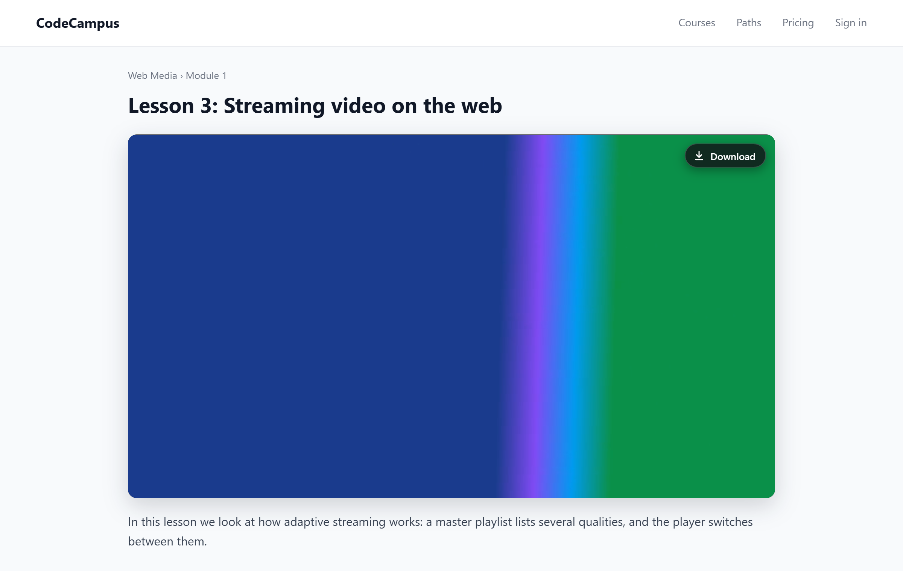
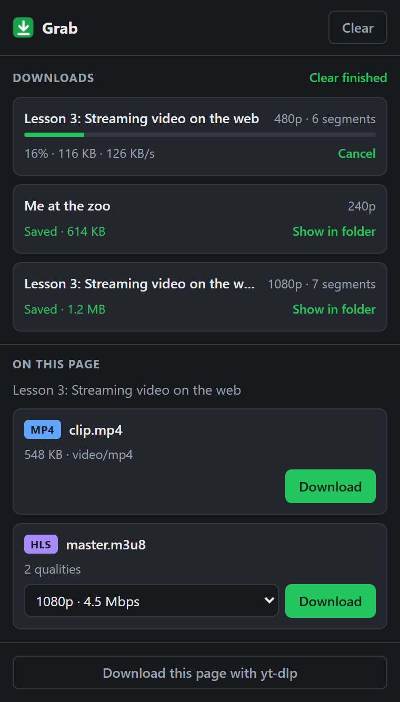
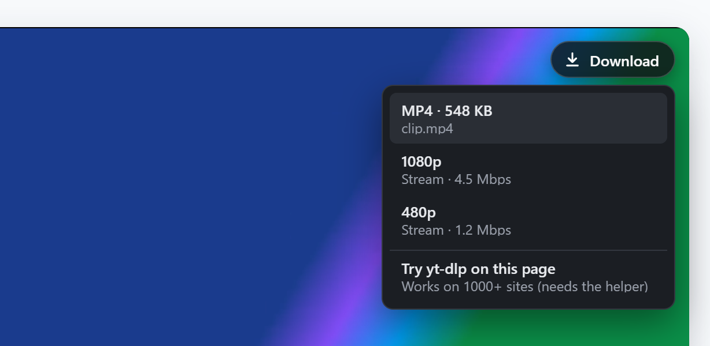
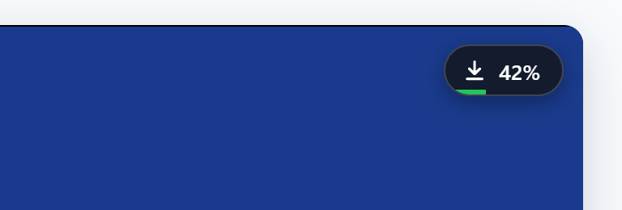
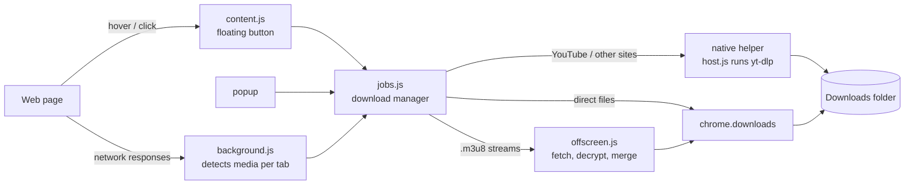

<div align="center">


# Grab – Video Downloader

**Hover any video. Click Download. Done.**

A lightweight IDM-style browser extension that finds the videos on a page and saves them:
direct files, HLS streams, and, through a tiny local helper, YouTube and 1000+ other sites.




</div>

## Features

<table>
<tr>
<td width="55%" valign="top">

**Floating Download button**<br>
Appears when you hover a video or press play. With one source it downloads immediately.
With several, you pick the quality.

**Streams, not just files**<br>
Downloads HLS (`.m3u8`) streams segment by segment, decrypts AES-128, and merges them
into one file. Fragmented-MP4 streams save as `.mp4`.

**One-click YouTube & 1000+ sites**<br>
An optional helper hands the page to [yt-dlp](https://github.com/yt-dlp/yt-dlp), with
live progress in the browser. YouTube saves as H.264/AAC MP4, which plays everywhere.

**Runs quietly in the background**<br>
No extra tabs. Progress shows on the button and in the popup, and a notification
appears when a download finishes.

**Gets past simple hotlink protection**<br>
Requests carry the page's `Referer` / `Origin`, so CDNs that reject outside requests still serve the files.

</td>
<td width="45%" valign="top" align="center">

</td>
</tr>
</table>

<table>
<tr>
<td align="center"><br><sub>Pick a quality</sub></td>
<td align="center"><br><sub>Progress right on the video</sub></td>
</tr>
</table>

## Install

### 1. Load the extension
1. Download this repo (**Code → Download ZIP**, then extract it) or `git clone` it.
2. Open `chrome://extensions` (or `edge://extensions`).
3. Turn on **Developer mode** and click **Load unpacked**. Select the project folder.
4. Pin the green **Grab** icon to the toolbar.

That's enough for direct video files and HLS streams.

### 2. Optional: the yt-dlp helper (YouTube and other sites)
Windows, one time only:
```powershell
winget install OpenJS.NodeJS.LTS   # skip if you already have Node.js
winget install yt-dlp.yt-dlp
winget install Gyan.FFmpeg
powershell -ExecutionPolicy Bypass -File native-host\install.ps1
```
The installer registers the helper for Chrome and Edge, for your user only. Undo it with
`native-host\uninstall.ps1`.

## Usage

| Where | What to do |
|---|---|
| **On the video** | Hover it and click **Download**. Pick a quality if asked. |
| **Toolbar popup** | Lists all media found on the page, live downloads, Cancel and **Show in folder**. |
| **Anything else** | **Download this page with yt-dlp** in the popup, or **Try yt-dlp on this page** in the menu. |

Files are saved to your normal **Downloads** folder.

## How it works



1. **Detect.** `webRequest` watches responses for video/audio content types and `.mp4`, `.m3u8` and `.mpd` URLs.
   HLS playlists are read once to list their qualities.
2. **Choose.** The floating button or the popup sends a request to the job manager.
3. **Download** with the right engine:
   - **Direct files** go to `chrome.downloads`.
   - **HLS** goes to a hidden offscreen document. It fetches segments 6 at a time with retries,
     decrypts AES-128, and joins them into one file.
   - **Everything else** goes to the native helper, which runs yt-dlp and streams progress back to the extension.

<details>
<summary><b>Project structure</b></summary>

| File | Role |
|---|---|
| `manifest.json` | Permissions, content script, fixed extension ID (`key`) |
| `background.js` | Media detection per tab, badge count, message routing |
| `jobs.js` | Download manager: progress, cancel, notifications, Referer rules |
| `content.js` | Floating button and quality menu (shadow DOM, runs in all frames) |
| `offscreen.html/js` | Hidden page that downloads and merges HLS streams |
| `hls.js` | Playlist parser, segment downloader, AES-128 decryption |
| `popup.html/css/js` | Toolbar popup |
| `native-host/host.js` | Native messaging host that drives yt-dlp |
| `native-host/install.ps1` | Registers the helper for Chrome and Edge |

</details>

## Limitations
- **DRM-protected streams** (Netflix, Prime Video, Disney+, …) can't be downloaded, by design.
- **HLS downloads are held in memory** until saved, so very long streams need a lot of RAM.
- **DASH (`.mpd`) streams** are handed to yt-dlp, so they need the helper.
- The helper installer is **Windows-only** for now. `host.js` itself is cross-platform.

## Troubleshooting

<details>
<summary><b>"Helper not installed" even after running install.ps1</b></summary>

Reload the extension on `chrome://extensions`, then restart the browser so it picks up the
registry entry. The helper only accepts the ID `hhijjnchkhnknchphobiekkhhoacfgoa`, which is fixed by the
`key` in `manifest.json`. Don't remove that key.
</details>

<details>
<summary><b>The button doesn't appear</b></summary>

Reload the page after installing or updating the extension. Videos smaller than 220×130 px are ignored on purpose,
and so are YouTube feed previews.
</details>

<details>
<summary><b>A stream fails with HTTP 403</b></summary>

Some sites sign their URLs or check cookies more strictly. Use **Try yt-dlp on this page**, which knows
the quirks of many sites.
</details>

## Responsible use
Only download content you own or have permission to download. Many sites' terms of service forbid
downloading. Grab does not and will not circumvent DRM.
